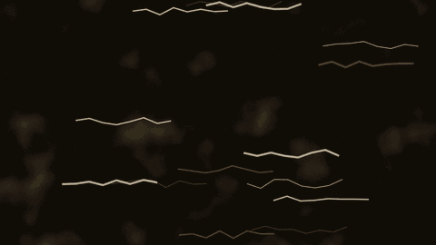

# AI 大战验证码

30 秒横屏动画，由纯代码生成。完整 prompt 见 [prompt.md](prompt.md)。

- **故事：** 光标连点被识破 → 装手抖、装犹豫、装点错 → 一层层钻进验证框 → 人类可信度 100% → 结尾把「我不是机器人」的「不」划掉。
- **规格：** 1920×1080，30fps，900 帧；H.264 + AAC。
- **风格：** 90 年代朋克地下杂志拼贴，只用黑、红、米三色，手绘线条沸腾，漫画爆炸框。
- **声音：** A 版只有代码合成音效；B 版加 120BPM 配乐，分段切换车库朋克、紧张闷音、真静音和慵懒爵士。
