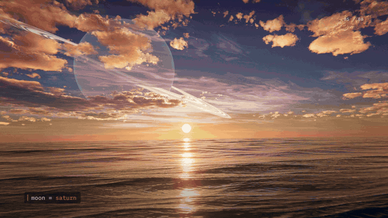

# 第一次日出 / FIRST LIGHT



I asked Claude Fable 5.2 to make whatever animation it wanted. This is what it made, with its full source code.

- **Story:** An AI says "I have seen countless sunrises. All of them were shot by you. This time, I will compute my own." Starting from one number, it builds light, sky, sun, sea and clouds layer by layer, then lets time run and the sunrise comes alive. Then: "Wait. If it is all computed, it can be changed." Eight what-if worlds fly past (two suns, 8-bit, aurora, ASCII, a ringed planet, 1984, an 1831 woodblock print, a black hole), it rewinds, and ends on "It isn't real. But it's mine."
- **Spec:** 106 s, 1920×1080, 60 fps.
- **Nothing pre-made:** no photos, video or audio samples. Every pixel is a WebGL shader (atmospheric scattering, a sea of 32 sine waves, volumetric clouds); every sound is synthesized in Python (numpy). The only outside things are four SIL OFL fonts, installed from npm (`@fontsource`), not bundled here.
- **Code:** as Fable 5.2 wrote it. The only changes: the Chrome path can be set with `CHROME`, and dependency versions are pinned.

## Files

| Path | What it is |
|---|---|
| `src/timeline.js` | The film's clock: sun height, camera and the eight variant worlds at every second. Picture and score share this one table |
| `src/glsl_world.js` | Main scene shader: atmosphere, sea, clouds, aurora, ringed planet, black hole |
| `src/glsl_luts.js` | Atmosphere lookup tables and cloud noise volumes |
| `src/post.js` `src/final.js` | Bloom, grading, the 8-bit / ASCII / woodblock styles, grain |
| `src/ui.js` | All text and diagrams (Canvas 2D) |
| `audio/synth.py` `audio/score.py` | The synthesizer and the score (120 BPM, D major) |
| `render.mjs` | Renders frames offline in headless Chrome on the GPU and pipes them to ffmpeg |
| `tools/make.sh` | Full build: score → picture in 8 segments → one MP4 with sound |

## Render it

Tested on macOS with Apple Silicon only: it uses Metal (through ANGLE) and VideoToolbox ProRes for the segment files. Needs Node 18+, Google Chrome, Python 3 with numpy and scipy, ffmpeg.

```bash
npm install
tools/make.sh                 # → out/第一次日出_FIRST_LIGHT_1080p60.mp4 (about 50 min, ~5.5 GB of segments in out/seg/)
tools/make.sh 48_58           # re-render one segment (0_20 20_36 36_48 48_58 58_64 64_68 68_86 86_106), then re-assemble
W=3840 H=2160 tools/make.sh   # 4K master, about 4× the time
node render.mjs stills '[{"out":"out/stills/a.jpg","t":50}]' --w 1920 --h 1080   # one frame at 50 s
```

If Chrome is not in `/Applications`, set `CHROME=/path/to/chrome`. The on-screen lines are in `src/ui.js` and `src/timeline.js` (the three opening lines are `INTRO`).

---

## 中文

我让 Claude Fable 5.2 自由发挥做一支动画，于是它做出了这个。这里是完整源码。

- **故事：** 一个 AI 说“我看过无数次日出，都是你们拍的，这一次我自己算一个”。它从一个数字开始，把光、天、太阳、海、云一层层算出来，让时间开始走，日出活过来。然后“等等，既然是算出来的，就可以改”：八个变体世界一路飞过（两个太阳、8-bit、极光、字符画、环行星、1984、1831 年浮世绘、黑洞），倒带回来，最后一句“它不是真的。但它是我的。”
- **规格：** 106 秒，1920×1080，60 帧。
- **没有现成素材：** 没有照片、视频、音频采样。画面全是 WebGL 着色器（大气散射、32 条 sin 叠出来的海、体积云），声音全是 Python（numpy）合成。唯一外来的是四款 SIL OFL 开源字体，`npm install` 时从 `@fontsource` 装，不放在这里。
- **代码：** 是 Fable 5.2 写的原样。只改了两处：Chrome 路径可以用 `CHROME` 指定；依赖版本锁定。

渲染方法见上面英文部分。只在 Apple Silicon 的 macOS 上测过（用到 Metal 和 VideoToolbox ProRes）。1080p 全片约 50 分钟，中间文件约 5.5 GB。台词在 `src/ui.js` 和 `src/timeline.js`（开场三行在 `INTRO`）。
